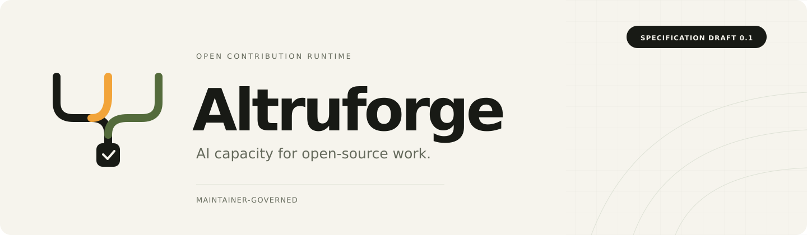
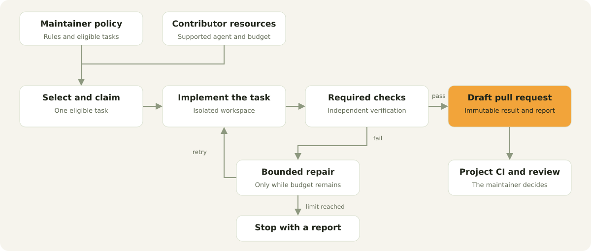

  <picture>
    <source media="(prefers-color-scheme: dark)" srcset="assets/hero-dark.svg">
    
  </picture>

  <strong>Contribute your AI capacity to the projects you care about.</strong> 
  A maintainer-governed harness for autonomous open-source contributions.

  
  
  
  
  

  <a href="#the-idea">The idea</a> ·
  <a href="#how-it-will-work">How it works</a> ·
  <a href="#build-the-first-mvp">Build the MVP</a> ·
  <a href="docs/README.md">Documentation</a> ·
  <a href="CONTRIBUTING.md">Contribute</a>

## The idea

People already pay for capable coding agents. Open-source maintainers already know what their projects need. Altruforge connects the two through project-owned rules, bounded execution, and reviewable pull requests.

A contributor supplies their supported AI tool and GitHub account. The maintainer defines eligible work, change boundaries, and acceptance checks. Altruforge selects a task, explains what it will do, carries out the work, and hands the result to the maintainer.

**Current status:** this repository contains the implementation brief, draft contracts, agent instructions, and an ordered MVP backlog. There is no executable release yet. The workflow below describes the product being built.

## How it will work

1. **Connect** your GitHub account and a supported coding tool through its supported sign-in flow.
2. **Choose** a repository that has opted in with `.altruforge/`.
3. **Start** a run with a time and retry budget. Altruforge chooses eligible work and tells you what it selected.
4. **Review the result:** a Draft PR, a verification report, and a clear account of what finished or stopped.
5. **The maintainer decides** what to merge.

<picture>
  <source media="(prefers-color-scheme: dark)" srcset="assets/workflow-dark.svg">
  
</picture>

### What makes the contribution useful

| For maintainers | For contributors |
| --- | --- |
| Work starts from an explicitly eligible task queue. | Choose a project and start a bounded run. |
| Repository rules define the permitted scope. | Keep control of your account and usage. |
| Required checks run outside the model's judgment. | See the selected task, progress, and final result. |
| Verified commit references accompany each handoff. | Support a project without managing each coding step. |

A successful local run does not certify correctness. Project CI and human review remain authoritative. A badge or an agent's own report cannot replace them.

## Build the first MVP

[Track the first MVP](https://github.com/Lephiziel/altruforge/issues/19).

Start with [the agent entry point](AGENTS.md), then [the implementation guide](docs/agents/START_HERE.md). The [backlog](docs/tasks/README.md) defines dependencies, acceptance criteria, and evidence for every work package.

| Milestone | Deliverable |
| --- | --- |
| **M0 — prove the boundary** | Supported Codex sign-in, isolation, cancellation, and recovery evidence on all three target operating systems. |
| **M1 — make a reliable local run** | Project validation, persistent state, GitHub workspaces, a Codex adapter, and an executor. |
| **M2 — coordinate and contribute** | Task leases, bounded orchestration, independent verification, and an idempotent Draft PR handoff. |
| **M3 — validate the public MVP** | Cross-platform end-to-end evidence, usable onboarding, and honest release artifacts. |

**MVP scope:** GitHub, one fully supported Codex adapter, local execution, repository-owned configuration, and Windows/macOS/Linux hosts. The initial build environment targets Linux-compatible projects.

A shared project hub, additional agent backends, native macOS/Windows build environments, and automatic responses to review feedback are later extensions. See [scope and non-goals](docs/product/mvp.md).

## Project-owned configuration

The draft [project manifest](spec/project-manifest.md) lives in `.altruforge/project.yaml`. It specifies task eligibility, allowed paths, checks, and run limits. The [example](examples/project.yaml) is a contract fixture, not an installation command.

The specification is published independently from the Go reference implementation so other tools can eventually implement it.

## Architecture

The reference CLI will use **Go**, **SQLite**, and adapters around documented agent protocols. Runtime state belongs to a local store; distributed task ownership belongs to a coordinator. Execution, verification, and publication have separate responsibilities.

Read [the architecture](docs/architecture.md), [the stack decision](docs/adr/0001-reference-runtime.md), and [the trust model](docs/security/threat-model.md).

## Contributing

Documentation review, protocol review, and bounded implementation work are welcome. Pick an unblocked [MVP task](docs/tasks/README.md), read its acceptance criteria, and follow [CONTRIBUTING.md](CONTRIBUTING.md).

All project content is written in English. AI-assisted contributions follow the same review and evidence requirements as other contributions.

[Report a bug](https://github.com/Lephiziel/altruforge/issues/new/choose) ·
[Propose a design](https://github.com/Lephiziel/altruforge/issues/new/choose) ·
[Security reporting](SECURITY.md)

## License

[Apache-2.0](LICENSE). Copyright Altruforge contributors. Provider names describe intended compatibility; no provider endorsement is implied.
